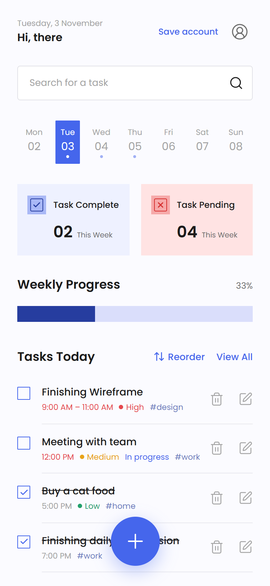
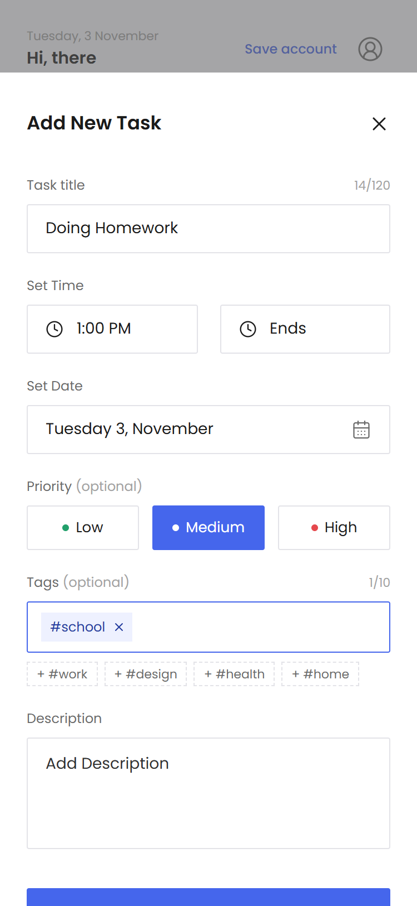
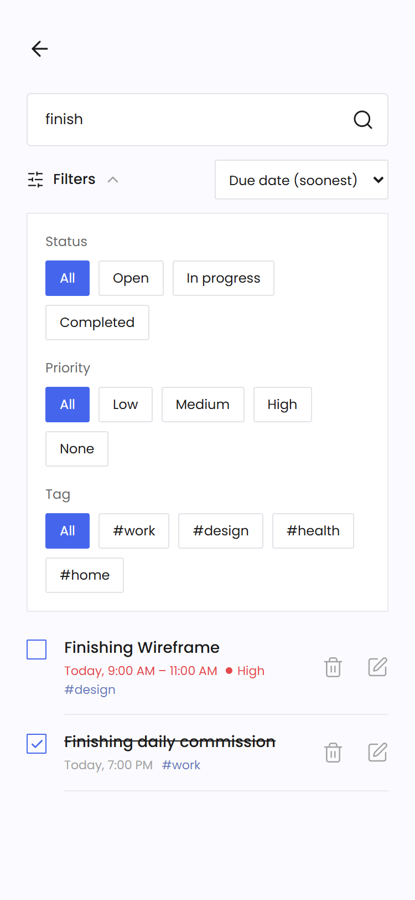
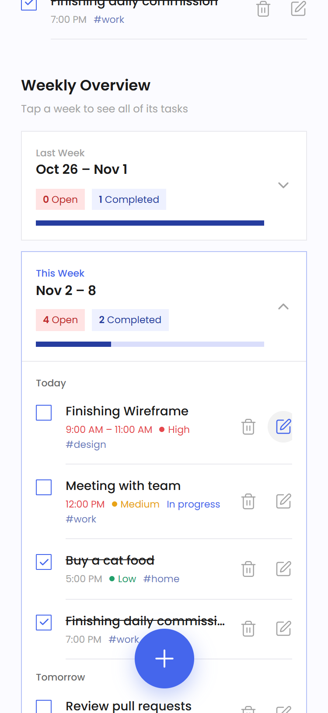
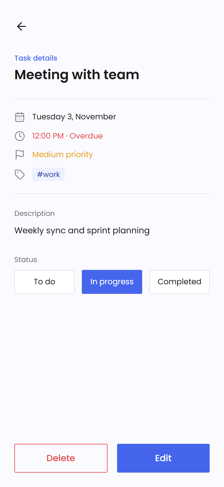
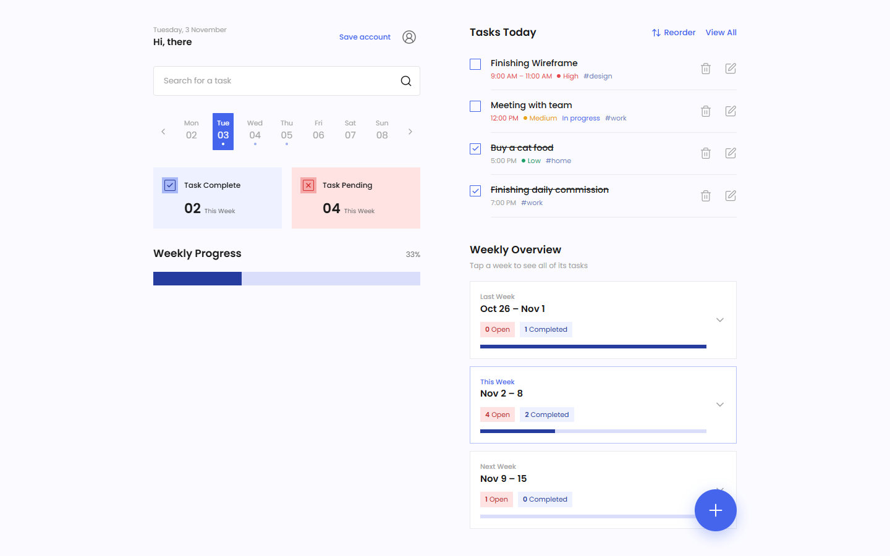

# To-Do List — MERN


A mobile-first to-do app that organises tasks by week (Monday → Sunday) and shows open vs. completed tasks for each week. It's built from the provided Figma design, has its own REST API, and supports multiple users with JWT authentication. There's no sign-up wall: **Get Started** goes straight to Home, as in the Figma.

- **Frontend:** React 19, React Router 7, Tailwind CSS 4, Vite, zod, dnd-kit, vite-plugin-pwa
- **Backend:** Node.js, Express, Mongoose / MongoDB, zod, JWT (jsonwebtoken + bcryptjs), helmet, express-rate-limit
- **Deploy:** Netlify. The Express API runs as a Netlify Function, so one site serves both the UI and the API.

> **Live demo:** _add your Netlify URL here_

## Screenshots

| Onboarding | Home | Add task | Search & filters |
| :---: | :---: | :---: | :---: |
|  |  |  |  |

| Weekly overview | Task details |
| :---: | :---: |
|  |  |

**Desktop (two-column layout):**



## Contents

1. [Quickstart](#1-quickstart)
2. [Environment setup](#2-environment-setup)
3. [Features](#3-features)
4. [Architectural choices](#4-architectural-choices)
5. [API reference](#5-api-reference)
6. [Testing](#6-testing)
7. [Deploying to Netlify](#7-deploying-to-netlify)
8. [Known trade-offs](#8-known-trade-offs)

---

## 1. Quickstart

You need **Node.js 20+** and npm. MongoDB is optional for local development.

```bash
git clone <your-repo-url> to-do-list
cd to-do-list
npm install                 # installs client + server (npm workspaces)
```

**Option A: no database setup.** This runs the API against a temporary in-memory MongoDB. The first run downloads a MongoDB binary (~600 MB).

```bash
npm run dev:mem
```

**Option B: your own MongoDB** (local or Atlas):

```bash
cp server/.env.example server/.env      # macOS / Linux
copy server\.env.example server\.env    # Windows (cmd / PowerShell)
# then edit MONGODB_URI and JWT_SECRET in server/.env
npm run dev
```

Open **http://localhost:5173** and tap **Get Started**. The web app runs on 5173 and the API on 4000, and Vite forwards `/api` to the API.

| Command | What it does |
| --- | --- |
| `npm run dev` | API (watch mode) + web app, using `server/.env` |
| `npm run dev:mem` | Same, with a throwaway in-memory database |
| `npm test` | API test suite (node:test + supertest + in-memory MongoDB) |
| `npm run build` | Production build of the web app (`client/dist`, with service worker) |
| `npm start -w server` | Run only the API (production style) |

## 2. Environment setup

`server/.env` (template: [`server/.env.example`](server/.env.example)):

```dotenv
MONGODB_URI=mongodb://127.0.0.1:27017/todolist   # or your Atlas connection string
JWT_SECRET=change-me-to-a-long-random-string     # required in production
JWT_EXPIRES_IN=7d                                # login lifetime
CORS_ORIGIN=*                                    # your site URL in production
PORT=4000
```

To generate a secret: `node -e "console.log(require('crypto').randomBytes(48).toString('base64url'))"`

`client/.env.local` (optional, template: [`client/.env.example`](client/.env.example)):

```dotenv
VITE_API_URL=/api   # only change this if the API is hosted on another origin
```

If `JWT_SECRET` is missing, the API falls back to an insecure secret in development and logs a warning. In production (`NODE_ENV=production` or on Netlify) it **refuses to start** without one.

## 3. Features

### Assignment requirements

| Requirement | Where |
| --- | --- |
| Create a task: title\*, description, date & time\*, priority | **+** button → *Add New Task* sheet. Start time and date are required. The end time and tags are optional. |
| Edit any field | Pen icon on a task, or **Edit** on the task details screen |
| Delete | **Swipe a task left → Delete** (touch or mouse). The trash icon also deletes. Each delete shows an **Undo** toast. |
| Search by keyword | Search bar → matches title, description and tags. Each result supports **View** (tap), **Edit** (pen) and **Delete** (trash or swipe). |
| Tasks grouped by week, Monday–Sunday | The day strip shows the selected Mon–Sun week (swipe it, or use the arrows on desktop). **Weekly Overview** lists every week. Weeks are computed by MongoDB in the user's time zone. |
| Week cards: open / completed counts, expand to show tasks | *Task Complete / Task Pending* cards and *Weekly Progress* for the selected week. Weekly Overview cards expand to show that week's tasks. |
| Mark Completed / In progress | Checkbox on each task. The Status control (To do / In progress / Completed) is on the details screen and in the edit sheet. |
| Responsive mobile UI from the Figma | Onboarding, Home, Add Task sheet and Search match the design (Poppins, colours, spacing). On tablet and desktop, Home uses two columns and the sheet becomes a dialog. |

### Beyond the brief

| Area | Feature |
| --- | --- |
| **Multi-user + JWT auth, without a sign-up wall** | **Get Started** silently creates a private *guest account* (its own JWT), so the Figma flow (Onboarding → Home) is unchanged and every visitor gets their own task list. From the account menu, a guest can **Save Your Account** (add an email and password), which keeps all their tasks, or **Log in** to an existing account. Passwords are hashed with bcrypt. Users only ever see their own tasks. Auth endpoints are rate-limited. Guest accounts unused for 30 days are deleted with their tasks. |
| **Category tags** | Up to 10 tags per task, entered with Enter/comma or picked from suggestions. Tags are searchable and filterable. |
| **Filtering & sorting** | Filter panel: status (open / in progress / completed), priority (including "none") and tag. Sort by due date (either direction), priority, title or recently added. Filters are kept in the URL. |
| **Client-side + server search** | While you type, the loaded results are filtered instantly on the device. The debounced server search then replaces them. |
| **Drag-and-drop ordering** | **Reorder** mode in *Tasks Today* works with mouse, touch and keyboard (Space, then arrow keys). The order is saved to the API. |
| **Optimistic UI with rollback** | Ticking, deleting, changing status and reordering update the screen immediately. If the request fails, the change is undone and a toast explains why. |
| **Offline support** | Installable **PWA**: a service worker caches the app shell. API responses are cached **per user** in localStorage, so screens appear instantly and offline you see your saved tasks with an offline banner. Changes made offline are undone with a clear message. |
| **Real-time form validation** | A `useFormValidation` hook plus zod schemas show inline errors as you type: required fields, email format, password length, end time after start, tag limits, character counters. Server-side field errors appear inline too. |
| **Performance** | Cursor pagination with infinite scroll. Debounced search. `AbortController` cancels stale requests. Weekly counts are aggregated in MongoDB. Compound indexes cover the user's queries. |

## 4. Architectural choices

### Folder structure

```
server/src/
  app.js              Wires middleware and routes together; contains no business logic
  index.js            Local server entry point
  config/             env.js (validated config), db.js (cached Mongo connection, serverless-friendly)
  models/             Mongoose schemas: Task, User
  controllers/        Business logic + database access (taskController, authController)
  routes/             Endpoint → middleware → controller mapping only
  middleware/         asyncHandler, validate (zod), auth (JWT), rateLimit, errorHandler
  validators/         zod schemas for request bodies and query strings
  services/           guestCleanup (removes abandoned guest accounts)
  utils/              ApiError, JWT helpers, cursor pagination
server/test/          API tests
client/src/
  pages/              One file per screen (Home, Search, TaskDetail, TaskSheet, Auth, Onboarding)
  components/         Single-responsibility UI pieces
    task/             TaskList, TaskItem, TaskMeta, Checkbox, SortableTaskList
    form/             TaskInput (the task form), TagInput, field primitives
    FilterPanel, WeekStrip, SummaryCards, WeekOverviewCard, Sheet, SwipeToDelete, Toast, …
  hooks/              useFormValidation, useTaskListActions (optimistic), useTaskNavigation
  lib/                api client, auth + app context, offline cache, zod schemas, date helpers
client/public/        Favicon and PWA icons
netlify/functions/    api.js wraps the same Express app with serverless-http
netlify.toml          Netlify build settings, functions directory and redirects
docs/screenshots/     Images used in this README
```

**Why this layout:**

- **Separation of concerns.** Routes only declare *what* runs, controllers decide *how*, and models define *shape*. Each controller can be read without knowing about HTTP plumbing.
- **Validation as a layer.** Every request body and query string goes through a zod schema in `validate` middleware before reaching a controller. Unknown fields are stripped, so clients can't set `userId` or `priorityRank`. Values are coerced, and errors come back as `{ error, errors: { field: message } }`.
- **One error path.** `asyncHandler` forwards rejected promises, `ApiError` carries safe messages, and `errorHandler` maps every error (validation, Mongoose, malformed JSON, 404) to JSON. Stack traces are logged on the server and never sent to the client.
- **The same app runs locally and serverless.** `createApp()` is shared by `index.js`, the tests and the Netlify Function, so there's one code path to test.
- **Frontend:** pages compose components, components stay presentational where possible, and data logic lives in hooks and `lib/`. That's what keeps `TaskItem`, `TaskList`, `TaskInput` and `FilterPanel` small and reusable.

### Package choices

| Package | Why |
| --- | --- |
| **Tailwind CSS 4** | Fast, consistent styling straight from the Figma tokens (`@theme` in `index.css`). No CSS files to keep in sync. |
| **zod** (server + client) | One declarative way to describe and sanitise payloads, with good error messages. The same rules run in the browser for instant feedback. |
| **jsonwebtoken + bcryptjs** | Standard stateless auth. bcryptjs is pure JS, so it bundles cleanly into a Netlify Function (no native build). |
| **helmet, express-rate-limit** | Secure HTTP headers, and brute-force protection on login/register. |
| **@dnd-kit** | Accessible drag-and-drop (keyboard and screen-reader support) that works with touch. |
| **vite-plugin-pwa** | Generates the service worker and web manifest. |
| **date-fns** | Small, tree-shakeable date maths (Monday-based weeks). |
| **mongodb-memory-server + supertest** | Real MongoDB in tests and for zero-setup local dev. |

### State management: React Context (not Redux)

The app needs exactly two pieces of shared state:

1. **The session** (`AuthProvider`): token, user, login/logout.
2. **App events** (`AppProvider`): a `version` counter bumped after every successful change, plus toasts and online status.

Each screen owns its own server data (`useState` + fetch). After a successful change, every visible list refetches when `version` bumps, so the week cards, Tasks Today, search results and details always agree. They briefly show optimistic local state first. Redux Toolkit (or RTK Query) would add a store, slices and boilerplate without solving a problem this app has. The data is per-screen and server-owned, and Context re-renders are rare: only on login/logout or after a change. If the app grew offline write queues or many cross-screen caches, RTK Query would be the next step.

### Data model

`Task`:

| Field | Notes |
| --- | --- |
| `userId` | Owner; every query is scoped to it |
| `title`, `description` | |
| `dueAt` | Due date & time / start |
| `endAt` | Optional end time |
| `priority` | `low` / `medium` / `high` / `null` |
| `priorityRank` | Internal, for sorting |
| `status` | `todo` / `in_progress` / `completed` |
| `completedAt` | |
| `tags[]` | |
| `position` | Drag-and-drop order within a day |

`status` is used rather than an `isCompleted` boolean because the brief needs an *In progress* state.

`User`:

| Field | Notes |
| --- | --- |
| `name` | |
| `email` | Unique, lowercased; absent for guests |
| `passwordHash` | Never returned by the API; absent for guests |
| `isGuest` | |
| `lastActiveAt` | Used to clean up abandoned guest accounts |

## 5. API reference

All task routes require `Authorization: Bearer <token>`. Errors are always `{ error, errors? }`.

| Method | Path | Description |
| --- | --- | --- |
| POST | `/api/auth/register` | `{ name, email, password }` → `{ token, user }` |
| POST | `/api/auth/login` | `{ email, password }` → `{ token, user }` |
| POST | `/api/auth/guest` | Creates a guest account → `{ token, user }` (used by **Get Started**) |
| POST | `/api/auth/upgrade` | Guest → full account `{ name, email, password }`, keeping the same user id and all tasks |
| GET | `/api/auth/me` | Current user |
| GET | `/api/tasks` | List tasks (filters and options below) |
| POST | `/api/tasks` | Create `{ title, dueAt, description?, endAt?, priority?, status?, tags? }` |
| GET | `/api/tasks/:id` | One task |
| PUT / PATCH | `/api/tasks/:id` | Update any of the fields above |
| DELETE | `/api/tasks/:id` | Delete |
| GET | `/api/tasks/weeks?tz=Asia/Kolkata` | Per-week `{ weekStart, total, open, completed }` (Monday-based, in that time zone) |
| GET | `/api/tasks/tags` | The user's tags with counts |
| PUT | `/api/tasks/reorder` | `{ ids: [...] }` saves a drag-and-drop order |
| GET | `/api/health` | Health check |

`GET /api/tasks` query parameters:

| Parameter | Values / meaning |
| --- | --- |
| `q` | Keywords. All must appear in the title, description or tags. |
| `status` | `todo`, `in_progress`, `completed`, or `open` (= not completed) |
| `priority` | `low`, `medium`, `high`, or `none` |
| `tag` | One tag |
| `from`, `to` | ISO dates (due date range) |
| `sortBy` | `dueDate` (default), `priority`, `title`, `createdAt` |
| `order` | `asc`, `desc` |
| `limit` | 1–100 |
| `cursor` | The `nextCursor` value from the previous page |

Responses:

- **Without `limit`:** a plain array (capped at 500), used for one week.
- **With `limit`:** `{ items, nextCursor }`. The cursor is the sort values plus `_id` of the last item, so pages never skip or repeat tasks, even while tasks are being added or deleted.

Examples: `/api/tasks?status=completed`, `/api/tasks?sortBy=priority`, `/api/tasks?tag=work&sortBy=dueDate&order=desc&limit=20`.

## 6. Testing

```bash
npm test
```

There are 20 API tests. They cover:

- registration and login
- guest accounts: creating them, saving them as full accounts (tasks kept), and cleaning up abandoned ones
- user isolation: a user can't read, edit, delete or reorder another user's tasks
- validation and sanitisation
- PUT and PATCH
- 404s
- search across title, description and tags
- every filter
- every sort order
- cursor pagination with no gaps or duplicates, for every sort
- Monday-based weeks across time zones
- tags and reordering

The UI was checked end-to-end in a browser (Playwright + Edge, at phone, tablet and desktop sizes):

- **Get Started** going straight to Home with a private guest account
- saving a guest account (tasks kept), logging out and logging back in
- a second visitor seeing none of the first visitor's tasks
- creating a task with tags, and live validation in the task form and on the login screens
- swipe-to-delete, Undo, and optimistic rollback when the API fails
- drag-and-drop with mouse and keyboard
- debounced search, infinite scroll, request cancellation, filters and sorting
- offline mode: cached data, banner, undone changes

## 7. Deploying to Netlify

1. **MongoDB Atlas.**
   1. Create a free M0 cluster and a database user.
   2. Under **Network Access**, allow `0.0.0.0/0`, because Netlify Functions have no fixed IP.
   3. Copy the connection string and add a database name, e.g. `…mongodb.net/todolist?…`.
2. **Push this repo to GitHub.** Then in Netlify choose **Add new site → Import from Git**. `netlify.toml` already sets the build command, publish directory, functions directory and redirects.
3. **Set environment variables** under **Site configuration → Environment variables**: `MONGODB_URI`, `JWT_SECRET` (and optionally `JWT_EXPIRES_IN`, `CORS_ORIGIN`).
4. **Deploy.** The web app calls `/api/*`, which Netlify redirects to the function.

To host the API elsewhere (Render, Railway, …), run `npm start -w server` there and build the web app with `VITE_API_URL=https://your-api.example.com/api`.

## 8. Known trade-offs

- **Offline writes aren't queued.** Changes made offline are undone with a message, which is safer than syncing conflicting edits silently. Adding a write queue would be the next step.
- **Rate limiting is per server instance** (an in-memory store). A shared store such as Redis would be needed to enforce limits across many serverless instances.
- **Guest accounts live on one device** until they're saved. Clearing browser data loses access to a guest's tasks, which is why the account menu offers *Save Your Account*.
- **Keyword search uses escaped regular expressions,** which supports partial-word matches. At large scale, a MongoDB Atlas Search index would replace it.
